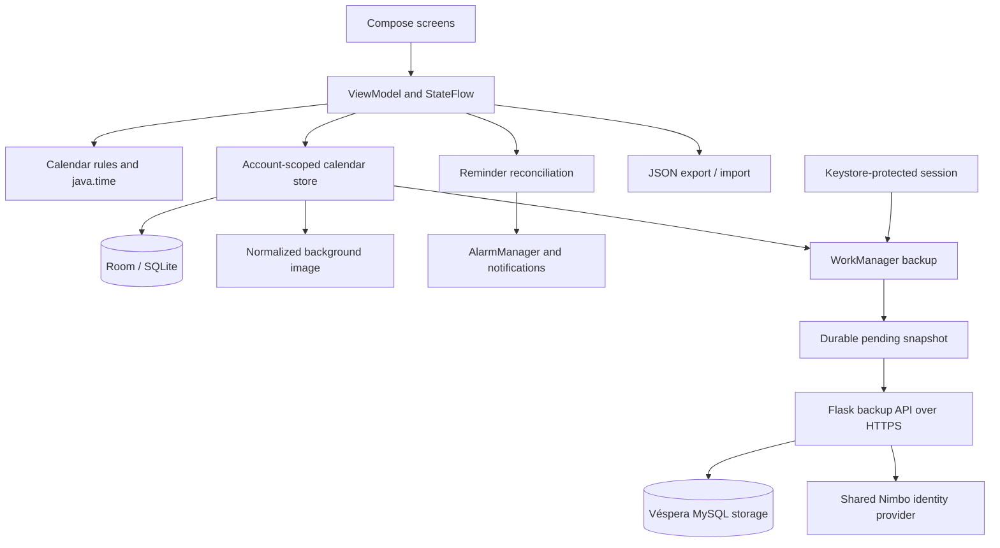
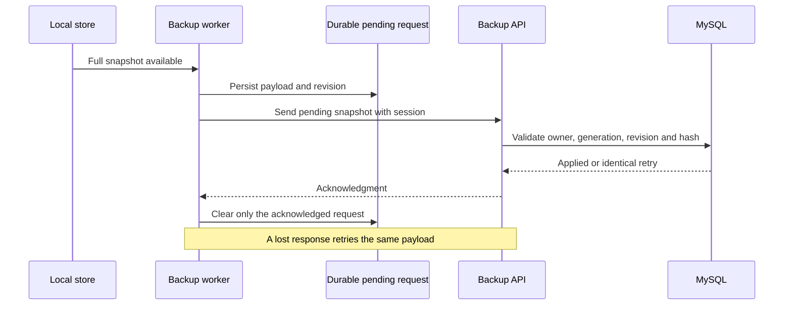

# Architecture

[Back to the showcase](../README.md)

## System view

The diagram describes logical responsibilities. The app is a single Android application, and the backup service is deployed separately. Production host names, operational paths, and credentials are outside this public case study.

## Android application

Compose renders calendar, special-date, settings, account, and recovery screens. A ViewModel exposes observable state through StateFlow and runs store operations with coroutines. Storage work runs off the UI thread; snapshots drive the interface.

The calendar store uses Room over SQLite with exported schemas and KSP code generation. Local databases are scoped by account identity. Switching accounts selects a different store; session checks prevent queued work from applying results to a later session.

## Calendar domain

| Record | Representation and behavior |
| --- | --- |
| Timed event | Start/end instants and an origin time zone. |
| All-day / multi-day event | Civil date range with an exclusive end date. |
| Birthday / anniversary | Month/day, optional origin year, annual projection, and leap-day policy. |
| Daily copies | Independent event IDs and revisions; validated and saved as a batch. |

These representations avoid shifting a birthday or an all-day event because of a UTC conversion. Time-zone rules remain relevant to timed occurrences, copying, and reminder calculation.

## Reminder scheduling

The reminder service derives occurrences from records and current settings, then reconciles desired alarms with scheduled state. Receivers trigger reconciliation after boot, clock/time-zone changes, upgrades, and exact-alarm permission changes. A delivery ledger suppresses repeated delivery of the same account/record-revision/occurrence/trigger combination.

AlarmManager handles time-sensitive reminders. WorkManager handles deferrable backup work. Exact delivery depends on platform permissions and device behavior; the interface exposes the available mode.

## Appearance and portable data

Styles, fonts, and photo settings form part of the full snapshot. Imported photos are decoded, normalized to JPEG, bounded to a 1280-pixel maximum side and 1 MiB payload, and stored as Base64 within the exported representation. The original URI is not required for recovery. Older snapshots without a photo remain valid.

Android 12 and later can use native RenderEffect blur; older supported versions use a separable blur implementation. This image normalization concerns visual portability and payload size, not encryption of calendar contents.

## Accounts and backup service

Véspera and Nimbo share authentication identity. Each app maintains its own session and application data. Android Keystore protects Véspera's stored session token with AES-GCM; the Room database is not described as an encrypted database.

The Flask service validates the session through the identity provider and derives the owner from that authenticated identity. Its MySQL storage is separate from Nimbo's application storage. It retains the latest full calendar snapshot for each device and uses revisions, content hashes, and owner generations for safe writes.

## Backup lifecycle

Local export/import uses validated JSON. Remote recovery previews the selected snapshot before application, and automatic recovery protects local edits made while a request was outstanding. These are full snapshots, not continuous cross-device merging.
