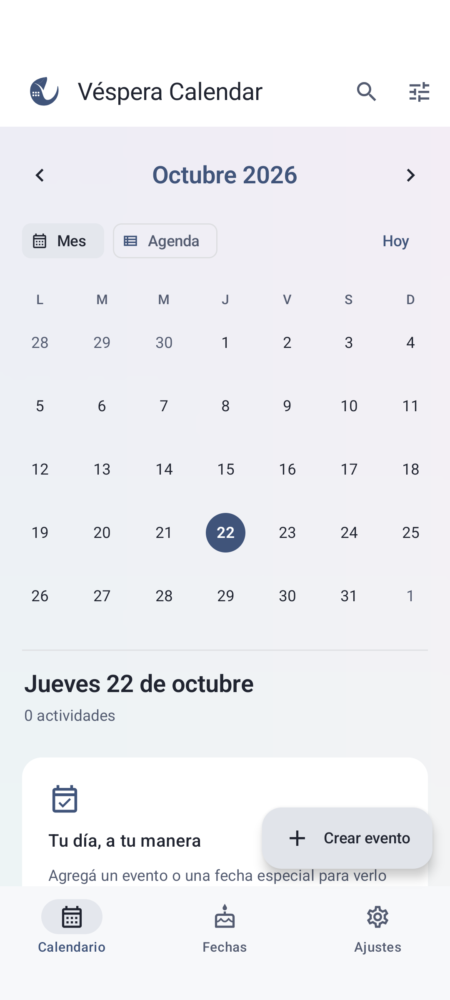
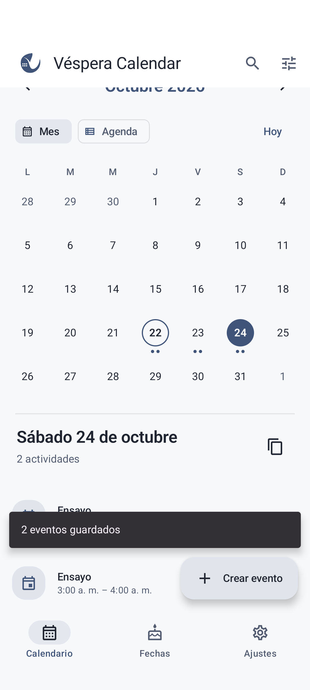
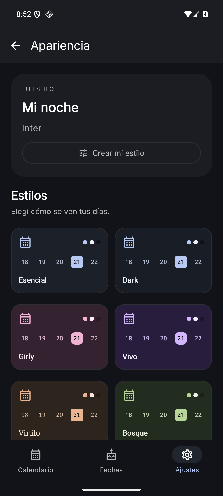
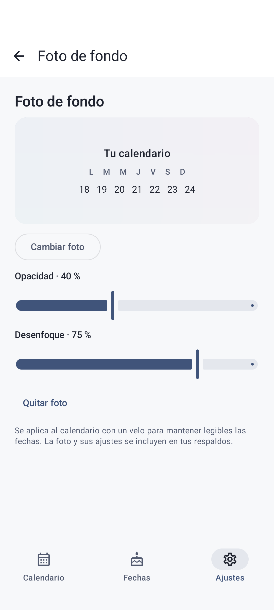
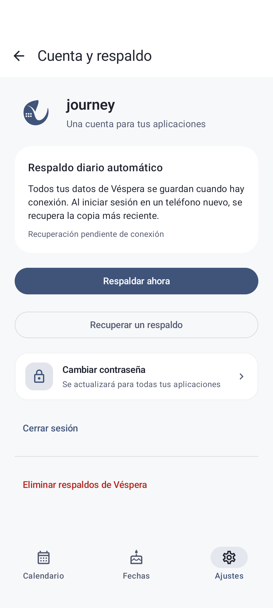

# Product tour

[Back to the showcase](../README.md)

## Plan a day

Use the month grid to choose a date or switch to the agenda. Search ignores accents, and filters narrow results by type. An event can be timed, all-day, or span multiple days, with notes and a written location.

## Reuse a schedule

Copy an individual event to another date, or copy the visible timed/all-day events of a day together. A finite daily repetition creates independent records over a range of up to 366 days. Each copy has its own identity and can later be edited or removed separately. Birthdays and anniversaries keep their annual rules and are excluded from day-copy batches.

## Remember important dates

Birthdays and anniversaries have their own section and appear each year in the calendar. The origin year is optional: when present, it supports age or anniversary counts. For February 29, the user can choose February 28 or March 1 in non-leap years.

## Make it personal

Choose among Esencial, Dark, Girly, Vivo, Vinilo, and Bosque. Personal styles support colors and light/dark variants. The app offers 33 offline fonts: 30 bundled families and three system choices.

  
  

Import a photo using Android's picker, adjust opacity and blur, and keep calendar text readable with a contrast veil. A normalized copy of the image travels with file and remote backups. The preview image here is a synthetic gradient from a UI test.

## Reminders with visible status

The app shows notification and alarm permission status. Local reminders use exact alarms when allowed, with an approximate alternative when needed. Privacy options control notification content. Device power management and permissions can affect delivery time.

## Keep and recover a calendar

Sign in with the same identity used by Nimbo Player. Calendar editing then works locally; remote backup requires connectivity. Export a complete JSON file or use manual and daily scheduled remote backup. Restore previews allow review before applying a snapshot, and appearance settings travel with the records.

Remote storage keeps the latest full snapshot per device. This supports recovery across installations; it is not a shared-calendar collaboration model. Written locations are text, with no map or geolocation integration documented here.

See [engineering decisions](ENGINEERING.md) and [image provenance](assets/README.md) for the implementation boundaries and capture versions.
